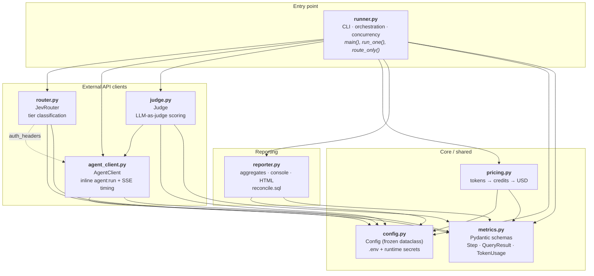
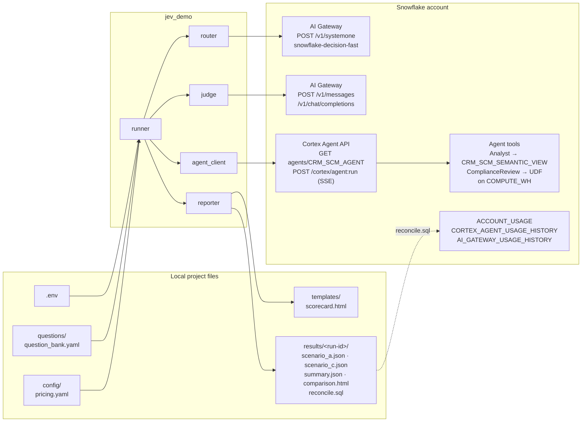
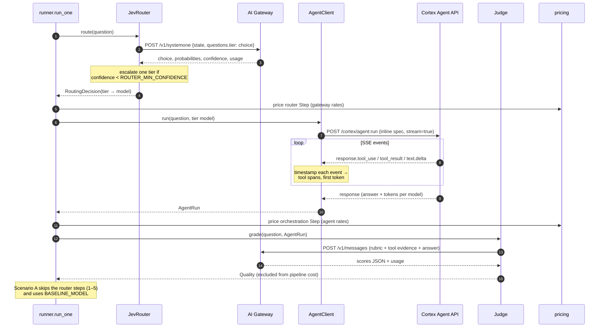

# Jev Router Demo — Software Architecture

## Purpose

`jev-demo` is a Python 3.12 command-line benchmark (uv project, package `src/jev_demo`). It runs the same set of CRM
questions through the `DEMO.CRM.CRM_SCM_AGENT` Cortex Agent in two configurations and compares them:

- **Scenario A:** one model (`claude-sonnet-4-5`) handles every query.
- **Scenario C:** the Jev decision model (`snowflake-decision-fast`) classifies each question into a tier, then dispatches
  it to that tier's model.

For every query it records latency, tokens, estimated cost, and judged quality for each step, then writes JSON results
and an HTML scorecard.

## Design principles

| Principle | How it shows up |
|---|---|
| **Identical agent, only the model varies** | The agent object's spec is fetched once and replayed inline on every run. Scenario A and C differ only in `models.orchestration`. |
| **Configuration over code** | Every model, endpoint, threshold and budget lives in `.env`. Pricing lives in `config/pricing.yaml`. Questions live in `questions/question_bank.yaml`. |
| **No secrets on disk** | The Snowflake PAT (and an optional TypeSafe key) is injected as an environment variable at runtime. `.env` holds no credentials. |
| **Measure every step** | Each LLM call and tool call becomes a `Step` with its own latency, tokens and cost. Per-query totals are always derived from the steps. |
| **Thin, single-purpose modules** | Each external API has one client module. Orchestration, pricing and reporting are separate. The data models have no I/O. |

## Module dependency diagram

All dependencies point downward. `metrics.py` has no internal imports, and `config.py` imports only third-party
libraries. The only dependency between client modules is the `auth_headers()` helper (from `agent_client.py`, used by
the router and judge) and the `AgentRun` type (used by the judge).

## System context and data flow

## Request lifecycle (one question, Scenario C)

## Module reference

| Module | Responsibility | Key types / functions | External interface |
|---|---|---|---|
| `runner.py` | CLI entry point (`jev-demo`). Loads questions, runs scenarios with a thread pool, assembles `QueryResult`s from steps, checks tool selection and SQL validity, writes JSON. `--route-only` mode checks router accuracy. | `main()`, `run_one()`, `agent_steps()`, `evaluate_tools()`, `route_only()` | argparse CLI, `rich` progress |
| `config.py` | Loads `.env` and runtime secrets into an immutable `Config`. Validates required settings and loads the pricing table. | `Config`, `load_config()`, `ROOT` | `python-dotenv`, `pyyaml` |
| `agent_client.py` | Fetches the agent spec once. Builds the inline run payload (model override, optional budget override). Streams SSE and times the tool spans and first text token. Parses token usage per model. | `AgentClient`, `AgentRun`, `ToolSpan`, `auth_headers()` | `GET /api/v2/databases/…/agents/{name}`, `POST /api/v2/cortex/agent:run` |
| `router.py` | Asks Jev a single `choice` question (tier1/2/3), applies low-confidence escalation, and maps the tier to its model. | `JevRouter.route()`, `TIER_QUESTION` | `POST <gateway>/v1/systemone` (TypeSafe System One format) |
| `judge.py` | Scores each answer against the tool evidence the agent actually retrieved: correctness, completeness and relevance (weighted 0.5 / 0.3 / 0.2). | `Judge.grade()`, `RUBRIC`, `WEIGHTS` | `POST <gateway>/v1/messages` (Claude) or `/v1/chat/completions` |
| `pricing.py` | Converts token usage into credits, pricing uncached input, cache reads, cache writes and output at separate rates. Converts credits to USD. | `credits_for()`, `to_usd()` | `config/pricing.yaml` (via `Config`) |
| `metrics.py` | Pydantic data model. `QueryResult` derives its totals (tokens, credits, cost) from its pipeline steps; the judge step is excluded. | `TokenUsage`, `Step`, `RoutingDecision`, `Quality`, `QueryResult` | none (pure data) |
| `reporter.py` | Computes per-scenario aggregates (mean, p50, p95, by tier, by step, router accuracy). Prints the console comparison and renders the HTML scorecard. Writes a `reconcile.sql` scoped to the run's time window. | `aggregate()`, `write_reports()` | `jinja2` template, `rich` tables |

## Data model

```mermaid
classDiagram
    class QueryResult {
        +str query_id
        +str scenario
        +int expected_tier
        +str question
        +str answer
        +str error
        +str agent_model
        +list tools_used
        +float total_latency_ms
        +float time_to_first_token_ms
        +tokens() TokenUsage
        +credits() float
        +cost_usd() float
        +step_latency(name) float
    }
    class Step {
        +str step
        +str model
        +str tool
        +float latency_ms
        +str status
        +float credits
        +float cost_usd
        +dict detail
    }
    class TokenUsage {
        +int input_tokens
        +int cache_read_tokens
        +int cache_write_tokens
        +int output_tokens
        +total() int
    }
    class RoutingDecision {
        +int tier
        +int raw_tier
        +str model
        +float confidence
        +dict probabilities
        +bool escalated
    }
    class Quality {
        +float correctness
        +float completeness
        +float relevance
        +float score
        +str rationale
        +bool sql_valid
        +bool tool_selection_correct
    }
    QueryResult "1" *-- "many" Step
    QueryResult "1" *-- "0..1" RoutingDecision
    QueryResult "1" *-- "1" Quality
    Step "1" o-- "0..1" TokenUsage
```

## Cross-cutting concerns

- **Authentication:** every call sends `Authorization: Bearer <PAT>`. The router can use a separate TypeSafe key when it
  points at TypeSafe's own endpoint (`Config.jev_token`).
- **Concurrency:** `ThreadPoolExecutor` (`--concurrency`, default 2) shares one `httpx.Client`. The pool size scales
  with concurrency.
- **Error handling:** router and judge HTTP errors are recorded on the `QueryResult` and don't abort the run. Agent
  stream errors and missing final events set `QueryResult.error`, and those queries are excluded from aggregates.
- **Timing model:** orchestration time = total − tool time − synthesis time. Synthesis time runs from the first
  `response.text.delta` event to the end of the stream. The Agent API reports tokens per model for the whole run, so
  orchestration tokens also include tool-call generation and synthesis.
- **Cost model:** estimates use account-derived rates (`sql/derive_pricing.sql`). The judge is excluded from pipeline
  cost and reported separately. Warehouse SQL compute is not estimated; `reconcile.sql` returns billed credits.
- **Extensibility:** Scenario B (a general-purpose LLM as the router) fits as a second router class with the same
  `route() → (RoutingDecision, TokenUsage, latency_ms)` contract, plus a `"B"` branch in `run_one()`. No other module
  needs to change.
